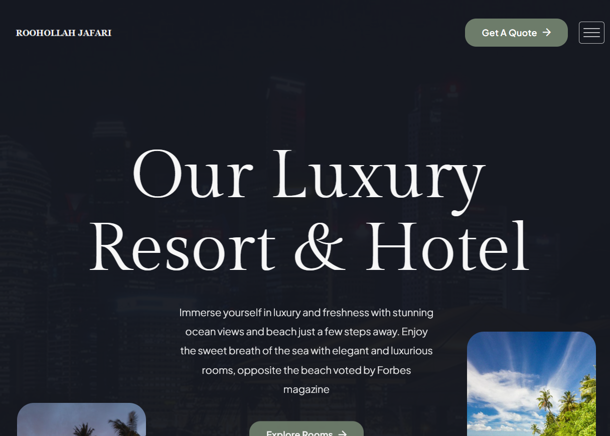
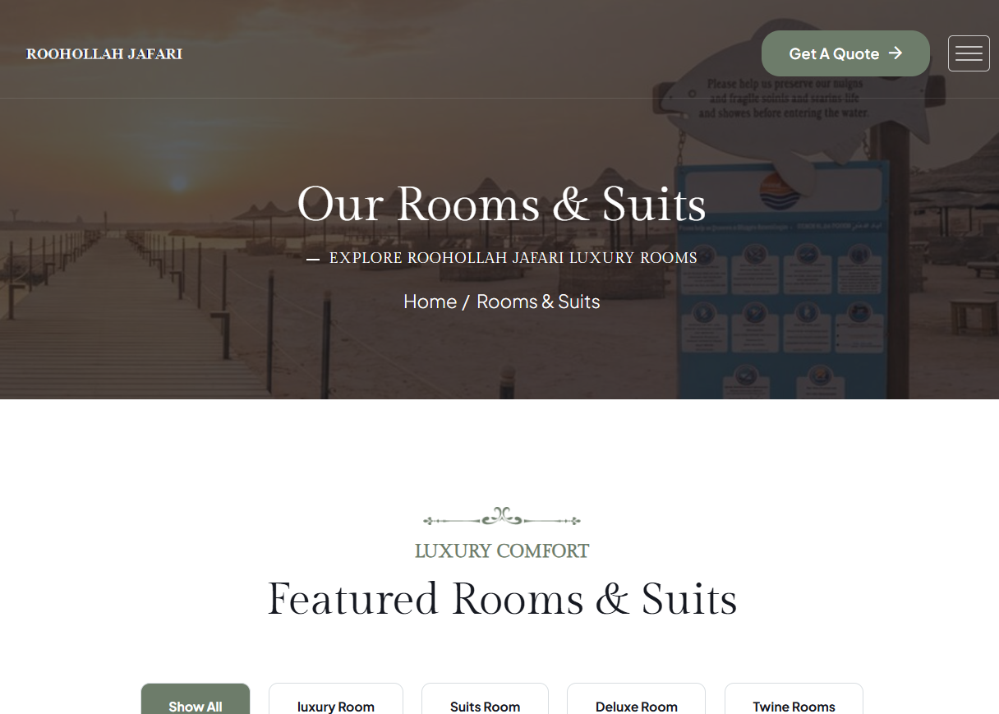
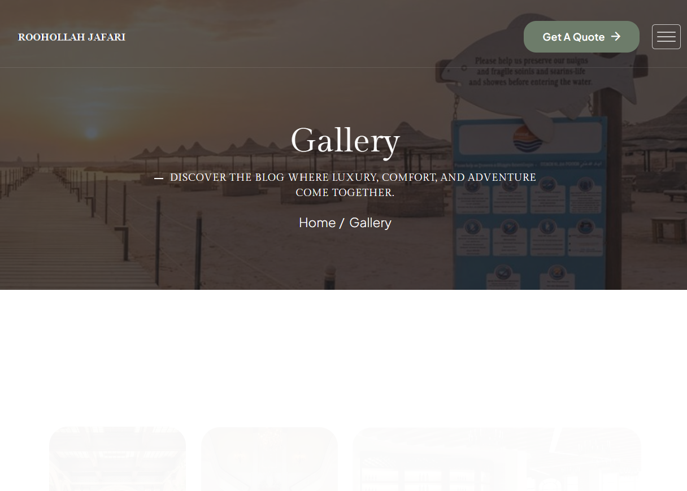
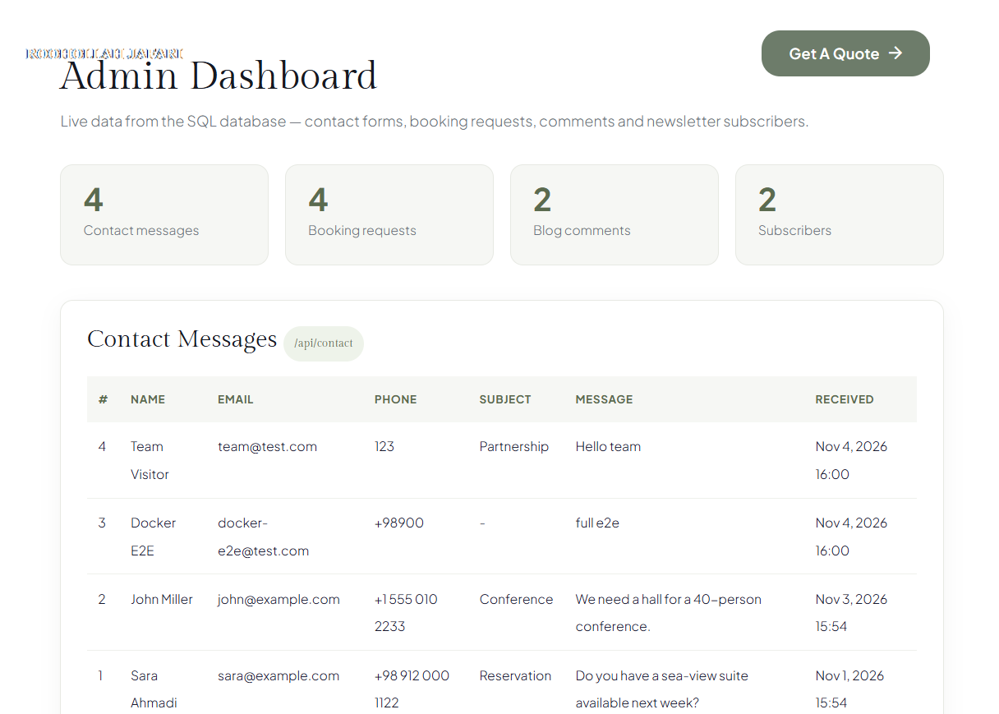

<div align="center">

# 🏨 وب‌سایت هتل و ریزورت

### ASP.NET Core Razor Pages · EF Core · PostgreSQL · Docker

**وب‌سایت هتل آماده تولید با فرم‌های واقعی، پنل ادمین زنده و REST API — کاملاً داکرایز شده.**

[شروع سریع](#-شروع-سریع) · [اسکرین‌شات‌ها](#-اسکرین‌شات‌ها) · [REST API](#rest-api) · [English](README.md)

</div>

---

برخلاف یک قالب HTML استاتیک، **همه بخش‌های تعاملی این پروژه واقعاً کار می‌کنند**:
فرم‌ها در دیتابیس ذخیره می‌شوند، پنل ادمین همان داده‌ها را زنده نشان می‌دهد و یک REST API
همه اطلاعات را در اختیار شما می‌گذارد. با یک دستور کل استک بالا می‌آید.

## ✨ امکانات

**فرانت‌اند —۲۱ صفحه**
- 🏠 سه نسخه خانه، اتاق‌ها (گرید و لیست)، جزئیات اتاق، خدمات، پیشنهادات، گالری، تیم، قیمت‌ها، سوالات، بلاگ (گرید/استاندارد/جزئیات)، تماس، 404
- 🎨 Layout مشترک + پارتیال‌ها (یک هدر، سه فوتر) — آدرس‌های `.html` قبلی حفظ شده
- 🔍 سرچ اتاق‌ها با بنر نتیجه، فیلتر زنده جستجوی بلاگ
- 📱 ریسپانسیو، انیمیشن‌های اسکرول AOS، پریلودر، اسلایدرها

**بک‌اند — وصل‌شده و واقعی**
- 📬 **۷ فرم** → PostgreSQL: تماس، رزرو (۴ صفحه)، کامنت بلاگ، خبرنامه — همراه با antiforgery و بنر موفقیت
- 🛠 **پنل ادمین** در مسیر `/admin/messages` — جدول‌های زنده از همه ثبت‌ها
- 🔌 **REST API** — سلامت سیستم و اندپوینت‌های CRUD (جدول پایین)
- 🗄 EF Core + ساخت خودکار جدول‌ها + داده نمونه
- 🔏 مدیریت خطای Production، صفحه 404 اختصاصی با کد واقعی، ریدایرکت `/index.html` → `/`

**عملیات**
- 🐳 Dockerfile چندمرحله‌ای + docker-compose با healthcheck و volume ماندگار
- 🔄 قابل سوییچ بین **PostgreSQL** (پیش‌فرض) و **SQL Server** فقط با متغیر محیطی
- ✅ **۲۲ تست E2E همه پاس** (همه صفحات، همه فرم‌ها، همه APIها، ریدایرکت‌ها،404)

## 📸 اسکرین‌شات‌ها

| | |
|---|---|
|  |  |
| **خانه** | **گرید اتاق‌ها** |

| | |
|---|---|
|  |  |
| **گالری** | **پنل ادمین (داده زنده دیتابیس)** |

🖼 **[همه۱۹ اسکرین‌شات](screenshots/)** — شامل [صفحه کامل](screenshots/01-home-full.png)،
فرم رزرو، فوتر، قیمت‌ها،404 و پاسخ‌های JSON API.

## 🚀 شروع سریع

```bash
git clone https://github.com/ruhollahjafari1994/razor-pages-hotel-website.git
cd razor-pages-hotel-website/RoohollahJafari.Web
docker compose up -d --build
```

تمام — جدول‌ها خودکار ساخته و seed می‌شوند.

| سرویس | آدرس |
|---|---|
| 🌐 وب‌سایت | http://localhost:5088 |
| 🛠 پنل ادمین | http://localhost:5088/admin/messages |
| ❤️ API سلامت | http://localhost:5088/api/health |
| 🐘 PostgreSQL | پورت `5432` (کاربر `roohollah`، دیتابیس `roohollah_jafari`) |

```bash
docker compose ps          # وضعیت
docker compose logs -f     # لاگ‌ها
docker compose down        # توقف (-v دیتابیس را هم پاک می‌کند)
```

## 🔌 REST API

| متد | مسیر | توضیح |
|---|---|---|
| GET | `/api/health` | وضعیت سیستم و دیتابیس |
| GET | `/api/contact` | لیست پیام‌ها |
| POST | `/api/contact` | ثبت پیام (JSON) |
| GET | `/api/contact/{id}` | یک پیام |
| GET | `/api/bookings` | درخواست‌های رزرو |
| GET | `/api/comments` | کامنت‌های بلاگ |
| GET | `/api/subscribers` | مشترکین خبرنامه |
| POST | `/subscribe` | عضویت خبرنامه |

## 🏗 معماری

```
razor-pages-hotel-website/
├── RoohollahJafari.Web/
│   ├── Dockerfile                 # multi-stage: sdk:10.0 → aspnet:10.0
│   ├── docker-compose.yml         # web + postgres17 + healthcheck + volume
│   ├── Program.cs                 # DI، مسیریابی، REST API، seed
│   ├── Models/Entities.cs         # ContactMessage · BookingRequest · BlogComment · Subscriber
│   ├── Data/AppDbContext.cs       # EF Core + EnsureCreated + seed
│   └── Pages/
│       ├── _Layout.cshtml         # هد، هدر، فوتر و اسکریپت‌های مشترک
│       ├── Shared/                # هدر + سه فوتر
│       ├── Admin/Messages.cshtml  # پنل ادمین
│       └── *.cshtml(.cs)          #۲۱ صفحه سایت + PageModel ها
├── screenshots/                   #۱۹ اسکرین‌شات آماده
└── README.md · README.fa.md
```

## ⚙️ پیکربندی

| متغیر | پیش‌فرض | توضیح |
|---|---|---|
| `Database__Provider` | `Postgres` | `Postgres` یا `SqlServer` |
| `ConnectionStrings__Default` | مقدار compose | رشته اتصال کامل |

برای SQL Server: سرویس `db-mssql` را در `docker-compose.yml` از کامنت خارج کنید،
دو متغیر محیطی `web` را تنظیم کنید و `docker compose up -d --build` بزنید.

## 🧪 تست

مجموعه تست E2E خودکار با **۲۲ چک** — همه پاس:

- همه۲۱ صفحه + ادمین → `200`
- `/index.html` → `301` · آدرس ناموجود → صفحه404 با کد واقعی404
- همه فرم‌ها → antiforgery → **ردیف در دیتابیس + ادمین + API دیده می‌شود**
- سرچ هدر → ریدایرکت با بنر · جستجوی بلاگ → فیلتر زنده
- لاگ کانتینر: صفر خطای unhandled

## 🛠 تکنولوژی

`ASP.NET Core10` · `Razor Pages` · `EF Core10` · `PostgreSQL17` ·
`Docker / Docker Compose` · `Bootstrap5` · `jQuery` · `AOS`

## 📌 نکات

- **عکس‌ها**: عکس‌های نمایشی از ریپوهای عمومی GitHub هستند — برای استفاده تجاری
  در `wwwroot/assets/images/` با همان نام و ابعاد جایگزین کنید و `docker compose up -d --build` بزنید.
- **لوگو**: فایل‌های متنی در `wwwroot/assets/images/logo/` هستند — با لوگوی گرافیکی خودتان عوض کنید.
- **اطلاعات تماس**: تلفن و آدرس در هدر و فوتر placeholder است.
- کلاس‌های CSS با پیشوند `luxivo-` بخشی از استایل‌شیت هستند — تغییرشان ندهید.

## ⭐ این پروژه به دردتان خورد؟

یک ستاره بدهید — واقعاً به دیده‌شدن پروژه کمک می‌کند.

ایده‌های توسعه (ورود ادمین، CMS، تقویم رزرو، چندزبانه) را در Issues مطرح کنید.

---

📄 [README in English](README.md)
