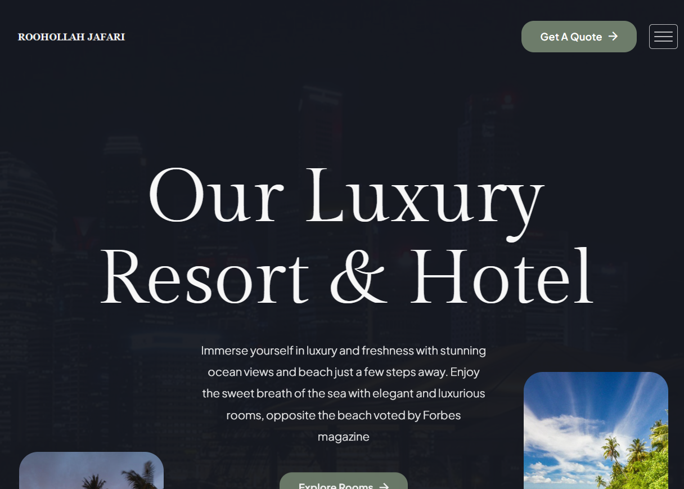
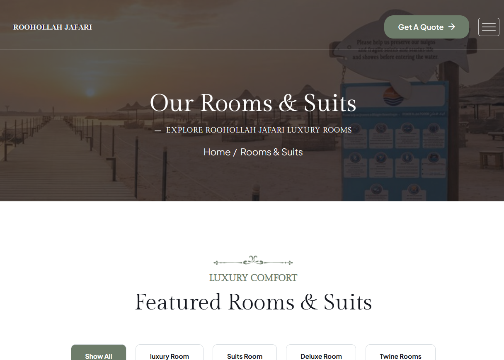
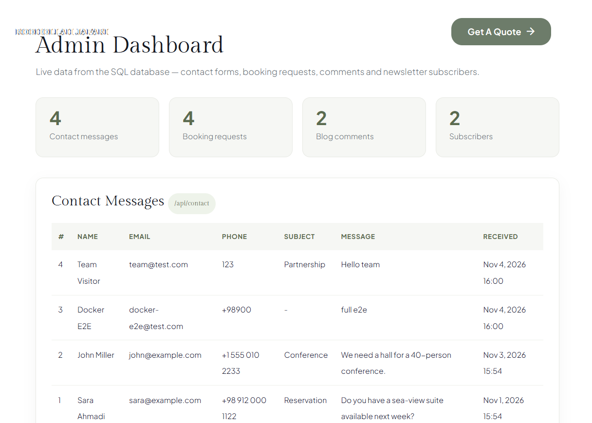
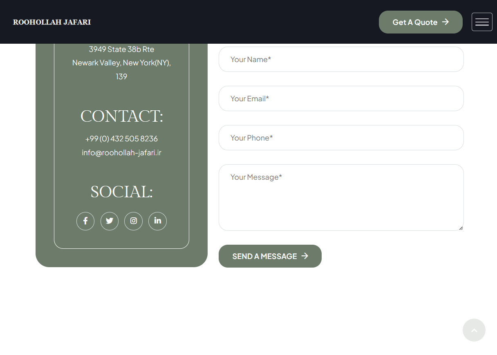

<div align="center">

# 🏨 Hotel & Resort Website — ASP.NET Core Razor Pages

**A production-ready <b>hotel booking website</b> built with ASP.NET Core Razor Pages, EF Core,
PostgreSQL and Docker — with working forms, a live admin dashboard and a REST API.**

[🌐 Live Demo](https://ruhollahjafari1994.github.io/razor-pages-hotel-website/) · [Quick Start](#-quick-start) · [Screenshots](#-screenshots) · [Features](#-features) · [REST API](#-rest-api) · [FAQ](#-faq) · [فارسی](README.fa.md)

[](https://ruhollahjafari1994.github.io/razor-pages-hotel-website/)


</div>

---

**What makes this different from a static HTML hotel template?** Every interactive part actually works:
the contact and booking forms write to PostgreSQL, the admin dashboard reads them back live, and a REST
API exposes the same data — all containerized and running with **one Docker command**.

## 📑 Table of Contents

- [Screenshots](#-screenshots)
- [Quick Start](#-quick-start)
- [Features](#-features)
- [REST API](#-rest-api)
- [Architecture](#-architecture)
- [Configuration](#-configuration)
- [Testing](#-testing)
- [Tech Stack](#-tech-stack)
- [FAQ](#-faq)

## 📸 Screenshots

| | |
|---|---|
|  |  |
| **Home page** | **Rooms grid** |

| | |
|---|---|
|  |  |
| **Admin dashboard (live DB data)** | **Contact form** |

🖼 **[All 19 screenshots](screenshots/)** — including a [full-page home capture](screenshots/01-home-full.png),
booking widget, gallery, pricing, custom 404 page and JSON API responses.

## 🚀 Quick Start

```bash
git clone https://github.com/ruhollahjafari1994/razor-pages-hotel-website.git
cd razor-pages-hotel-website/RoohollahJafari.Web
docker compose up -d --build
```

> 🌐 **Prefer just looking?** The static site is live at
> <https://ruhollahjafari1994.github.io/razor-pages-hotel-website/>
> — and the ready-to-host package is in [Releases](https://github.com/ruhollahjafari1994/razor-pages-hotel-website/releases/tag/v1.0-static) (unzip → upload to any hosting).

Database schema is created and seeded automatically — no migration commands needed.

| Service | URL |
|---|---|
| 🌐 Website | http://localhost:5088 |
| 🛠 Admin dashboard | http://localhost:5088/admin/messages |
| ❤️ Health API | http://localhost:5088/api/health |
| 🐘 PostgreSQL | `localhost:5432` (user `roohollah`, db `roohollah_jafari`) |

```bash
docker compose ps          # status
docker compose logs -f     # logs
docker compose down        # stop (add -v to drop the data volume)
```

<details>
<summary><b>Run without Docker</b> (local .NET 10 SDK + PostgreSQL or SQL Server)</summary>

```bash
cd RoohollahJafari.Web
export Database__Provider=Postgres
export ConnectionStrings__Default="Host=localhost;Port=5432;Database=hotel;Username=postgres;Password=***"
dotnet run
```
</details>

<details>
<summary><b>⭐ Run in Visual Studio with SQL Server (real data, F5 debugging)</b></summary>

1. Open **`RoohollahJafari.sln`** in Visual Studio 2022/2026.
2. Select the **`http`** profile and press **F5** → <http://localhost:5000>.
3. On first run the app **creates and seeds `RoohollahJafariDb` automatically** in
   **SQL Server LocalDB** (ships with Visual Studio) — no SSMS setup or migration commands needed.

- Submit any booking / contact form → the row is saved to **SQL Server** → see it live at
  `/admin/messages` or via `/api/bookings`.
- Config lives in `appsettings.Development.json` (`Database__Provider = SqlServer`,
  `Server=(localdb)\MSSQLLocalDB`).
- Browse the data in Visual Studio: **Server Explorer → Connect → SQL Server →
  `(localdb)\MSSQLLocalDB` → databases → `RoohollahJafariDb` → Tables**, or from a terminal:

  ```bash
  sqlcmd -S "(localdb)\MSSQLLocalDB" -d RoohollahJafariDb -Q "SELECT * FROM BookingRequests"
  ```
- Port `5000` (Visual Studio) and `5088` (Docker) don't clash, so both can run side by side.
  Note they use **separate databases** (LocalDB vs PostgreSQL container).
</details>

## ✨ Features

**Frontend — 21 pages**
- 🏠 Three home variants · rooms grid & list · room details · services · offers · gallery · team · pricing · FAQs · blog (grid / standard / details) · contact · custom 404
- 🎨 Shared `_Layout` + partials (one header, three footer variants); original `.html` URLs preserved
- 🔍 Room search with a results banner · live blog search filtering
- 📱 Responsive, scroll animations (AOS), preloader, sliders

**Backend — everything wired**
- 📬 **7 forms → PostgreSQL**: contact, booking (4 pages), blog comments, newsletter — antiforgery-protected with success banners
- 🛠 **Admin dashboard** at `/admin/messages` — live tables of every submission
- 🔌 **REST API** — health check + JSON endpoints (below)
- 🗄 EF Core with automatic schema creation and demo seed data
- 🔐 Production error handling, custom 404 with a real `404` status, `/index.html` → `/` redirect

**DevOps**
- 🐳 Multi-stage `Dockerfile` + `docker-compose.yml` with healthchecks and a persistent volume
- 🔄 Database provider switchable between **PostgreSQL** (default) and **SQL Server** via env vars
- ✅ **22/22 end-to-end tests passing** — every page, every form, every API endpoint, redirects, 404

## 🔌 REST API

| Method | Endpoint | Description |
|---|---|---|
| GET | `/api/health` | System + database status |
| GET | `/api/contact` | List contact messages |
| POST | `/api/contact` | Create a message (JSON) |
| GET | `/api/contact/{id}` | Single message |
| GET | `/api/bookings` | Booking requests |
| GET | `/api/comments` | Blog comments |
| GET | `/api/subscribers` | Newsletter subscribers |
| POST | `/subscribe` | Newsletter form post |

```json
GET /api/health
{ "status": "healthy", "database": "up", "provider": "Postgres", "time": "2026-11-04T16:43:03Z" }
```

## 🏗 Architecture

```
razor-pages-hotel-website/
├── RoohollahJafari.Web/
│   ├── Dockerfile                 # multi-stage build: sdk:10.0 → aspnet:10.0
│   ├── docker-compose.yml         # web + postgres17 + healthcheck + volume
│   ├── Program.cs                 # DI, routing, REST API, seed
│   ├── Models/Entities.cs         # ContactMessage · BookingRequest · BlogComment · Subscriber
│   ├── Data/AppDbContext.cs       # EF Core + EnsureCreated + demo seed
│   └── Pages/
│       ├── _Layout.cshtml         # shared head / header / footer / scripts
│       ├── Shared/                # _Header + 3 footer variants
│       ├── Admin/Messages.cshtml  # admin dashboard
│       └── *.cshtml(.cs)          # 21 site pages + PageModels
├── screenshots/                   # 19 marketing-ready screenshots
└── README.md · README.fa.md
```

**Request flow:** browser → Razor Page (antiforgery) → PageModel → EF Core → PostgreSQL
&nbsp;&nbsp;·&nbsp;&nbsp; app → REST API → same DbContext

## ⚙️ Configuration

| Variable | Default | Notes |
|---|---|---|
| `Database__Provider` | `Postgres` | `Postgres` or `SqlServer` |
| `ConnectionStrings__Default` | compose value | full connection string |
| `ASPNETCORE_URLS` | `http://+:8080` | set in Dockerfile |

Switching to SQL Server: uncomment the `db-mssql` service in `docker-compose.yml`,
set the two env vars on `web`, then `docker compose up -d --build`.

## 🧪 Testing

Automated end-to-end suite (PowerShell + real browser) covering **22 checks — all passing**:

- all 21 pages + admin dashboard → `200`
- `/index.html` → `301 /` · unknown URL → branded `404` page with a real `404` status
- every form (contact, booking ×4, comment, newsletter) → antiforgery token → **row visible in DB, admin and API**
- hero search → redirect with results banner · blog search → live filtering
- `docker logs` — zero unhandled exceptions

## 🛠 Tech Stack

`ASP.NET Core 10` · `Razor Pages` · `Entity Framework Core 10` · `PostgreSQL 17` ·
`Docker / Docker Compose` · `Bootstrap 5` · `jQuery` · `AOS`

## ❓ FAQ

**Can I run this hotel website with one command?**
Yes — `docker compose up -d --build` starts the web app and PostgreSQL, creates the schema and seeds demo data.

**Does the contact form actually save data?**
Yes. All seven forms post to Razor Page handlers protected by antiforgery tokens and stored via EF Core in PostgreSQL — visible at `/admin/messages` and through the REST API.

**How do I switch from PostgreSQL to SQL Server?**
Set `Database__Provider=SqlServer` and a SQL Server connection string — the EF Core provider is already referenced.

**Can I use this as a hotel booking template?**
It ships with 21 fully styled pages plus working booking forms, an admin dashboard and APIs — a solid starting point for a real hotel or resort site.

**Where do I change the logo and images?**
Logos: `wwwroot/assets/images/logo/` · All photos: `wwwroot/assets/images/` (same file names and sizes), then rebuild the image.

## 📌 Notes

- **Images**: demo photos come from public GitHub repositories — replace them in
  `wwwroot/assets/images/` (same names/sizes) and run `docker compose up -d --build` for production use.
- **Contact info**: phone/address in header & footer are placeholders.
- CSS class names prefixed `luxivo-` are part of the stylesheet — keep them.

## ⭐ Found this useful?

Give it a star — it really helps the project get discovered.

**Roadmap ideas welcome**: admin login, CMS-backed content, booking calendar, i18n —
open an issue or a PR!

---

📄 [README فارسی](README.fa.md)
